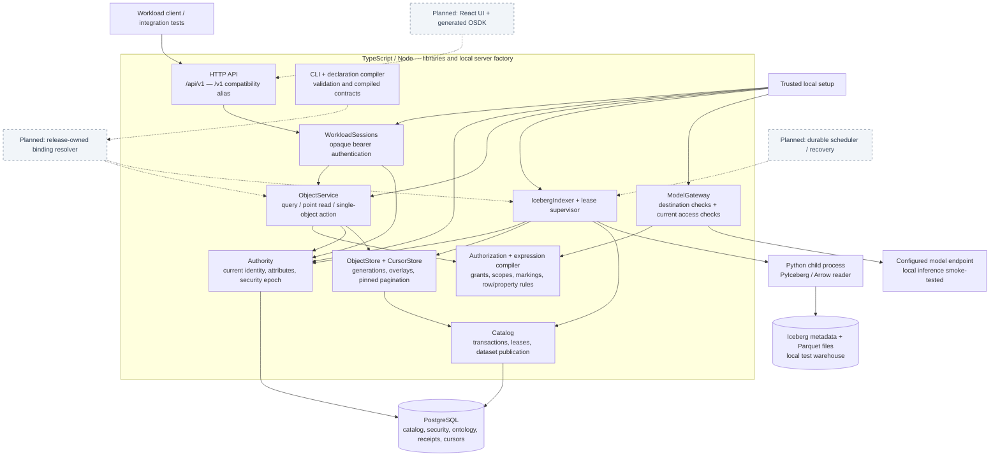
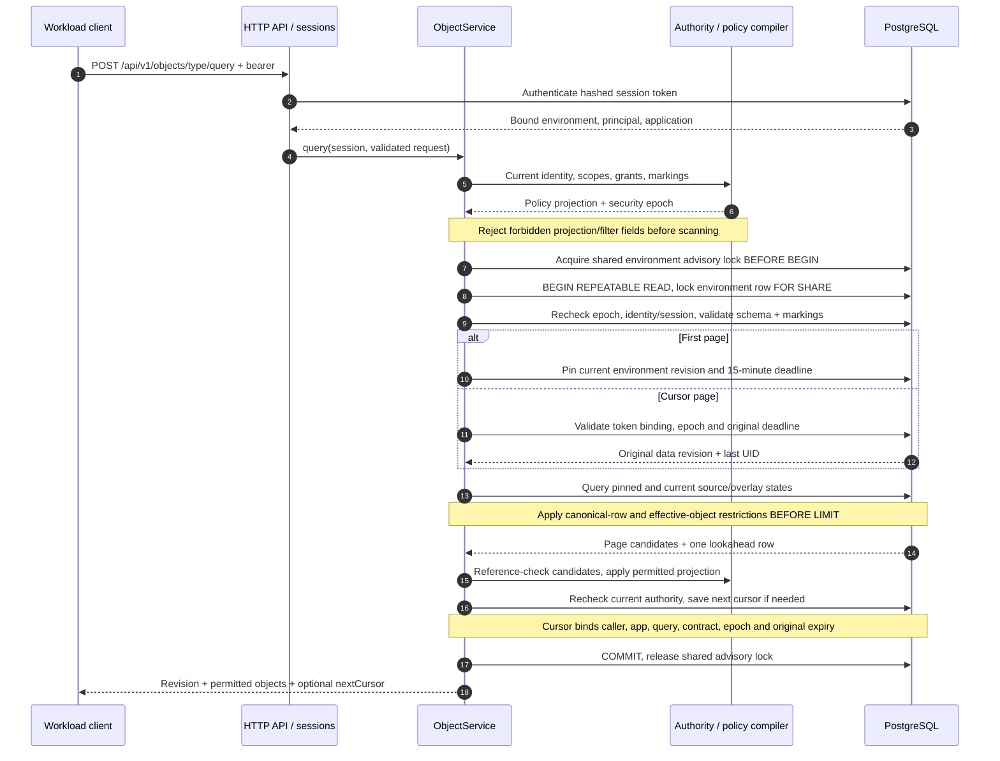
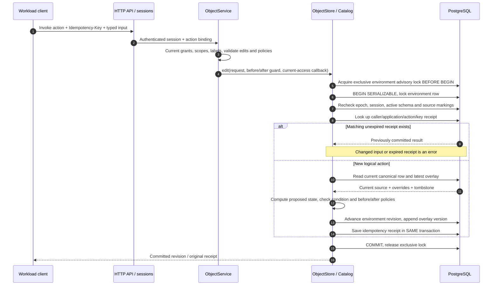
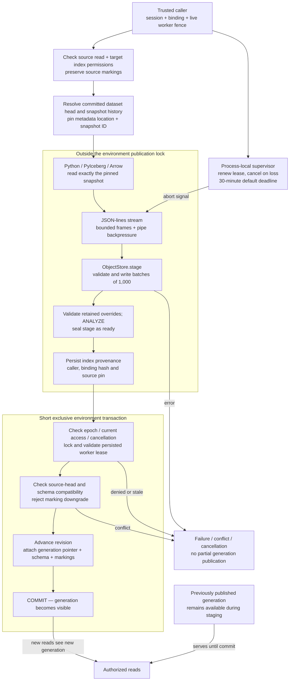
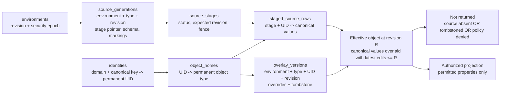

# Moria technical diagrams — implemented state

Based on implementation commit `618b2eb`, October 15, 2026. These diagrams describe the current prototype, not the complete target platform. Boxes represent code components unless explicitly labeled as storage or a process. They do not imply independent deployments.

Rendered SVG copies are available without a Mermaid extension:

| Diagram | SVG |
|---|---|
| Component architecture | [Open](diagrams/01-architecture.svg) |
| Protected query sequence | [Open](diagrams/02-query.svg) |
| Action and idempotency sequence | [Open](diagrams/03-action.svg) |
| Iceberg staging and publication | [Open](diagrams/04-indexing.svg) |
| Object state and reanimation | [Open](diagrams/05-object-state.svg) |

The Mermaid blocks below are the editable sources. SVGs were rendered with Mermaid CLI 12.0.0 using the neutral theme; rendering tools are development-only and are not application dependencies.

## 1. Component architecture

Solid components are implemented. Dashed connections to gray components are planned integrations. Trusted setup supplies bindings and workload credentials; there is no public administration endpoint.

The model gateway is a separate internal library, not an HTTP route or an agent runtime. Its caller supplies a trusted current-authorization resolver. The Python reader is a child process; production worker sandboxing is not implemented. Rust exists in the comparison benchmark, not in the production serving path.

Sources: [API](../apps/api/src/server.ts), [service](../services/ontology/src/service.ts), [indexer](../services/ontology/src/indexer.ts), [security](../services/security/src/authority.ts), [gateway](../services/model-gateway/src/gateway.ts), [compiler](../packages/compiler/src/index.ts).

## 2. Policy-aware paginated query

A cursor pins the data revision, **not authorization**. Every page must remain allowed under current identity, current policies and current object visibility.

No transaction stays open between pages. Query ordering is UID ascending. Arbitrary sort, aggregation and link traversal remain unsupported. A policy/SQL disagreement fails closed instead of returning the row.

Sources: [ObjectService.query](../services/ontology/src/service.ts), [SQL query builder](../services/ontology/src/query.ts), [cursor persistence](../services/ontology/src/cursors.ts), [transaction admission](../services/catalog/src/catalog.ts).

## 3. Single-object action and idempotent replay

Serialization/deadlock failures retry the database-only transaction up to three attempts. No user code or external network side effect runs inside this transaction. Action writes are currently single-object; multi-object actions and an external-effects outbox are pending. Changing between `/v1` and `/api/v1` does not change the idempotency scope.

Sources: [action service](../services/ontology/src/service.ts), [overlay edits](../services/ontology/src/store.ts), [receipt transaction](../services/catalog/src/catalog.ts).

## 4. Catalog-pinned Iceberg indexing and atomic visibility

Only pointer/metadata publication is performed under the exclusive environment lock; the rows are already staged. Compatible same-schema refreshes may cross intervening edits if the source head is unchanged. Failed stages and all generation history are retained; safe garbage collection is pending. Database waits are not immediately interrupted by cancellation.

**Two distinct publications:** this diagram starts with an already committed dataset snapshot. Dataset publication itself uses `Catalog.publish` to commit Iceberg metadata pointers, snapshot history, a receipt and an optional connector checkpoint atomically. It does not copy Parquet files into PostgreSQL. Ontology publication then separately attaches the staged serving rows. There is no single transaction spanning both publications.

The current coordinator supports ordinary Dataset inputs. Restricted views remain valid ontology sources in the spec, but their indexing policy-binding integration is unfinished. They cannot be transform inputs.

Sources: [indexer](../services/ontology/src/indexer.ts), [lease supervision](../services/ontology/src/lease.ts), [stream adapter](../workers/iceberg/stream.ts), [Python reader](../workers/iceberg/worker.py), [stage publication](../services/ontology/src/store.ts), [dataset publication](../services/catalog/src/catalog.ts).

## 5. Object state, revisions and reanimation

This is a logical storage map, not a complete foreign-key ER diagram. Both current and pinned reads compose a source generation with the latest overlay at the relevant revision.

- If a UID disappears from the source, its overlays and permanent identity remain.
- If that same UID returns, retained edits apply again; a retained tombstone still hides it.
- Setting a property to null is an explicit override. Clearing an override reveals the current source value.
- UID reuse for a different entity is not allowed. Multiple source systems are coalesced by transforms upstream; the store does not perform entity resolution.
- Legacy generations use `source_rows` instead of a stage pointer and remain readable. Legacy schema/marking metadata needs authoritative migration before production use.

Sources: [identity allocation](../services/catalog/src/catalog.ts), [source and overlay storage](../services/ontology/src/store.ts), [policy projection](../packages/authorization/src/objects.ts).

## What these diagrams do not claim

No React/OSDK demonstrator, human OIDC, deployed management API, durable job recovery, complete release resolver, production worker isolation, or complete audit/backup/restore exists yet. The diagrams show implementation boundaries, not production readiness. See [morning report](MORNING-REPORT-2026-10-15.md) for test/benchmark evidence and [implementation checkpoint](IMPLEMENTATION.md) for subsequent changes.
