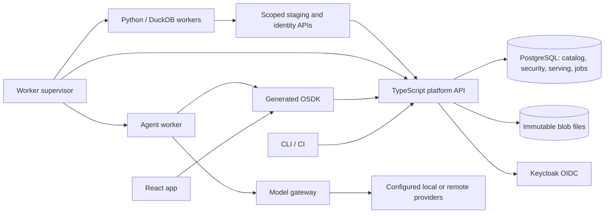

# Moria — architecture decision record

Status: reviewed defaults accepted, with Iceberg revision and the terminal restricted-view boundary finalized. October 14, 2026. Sources below were consulted for component capabilities. No benchmarks, deployment or interoperability tests have been performed. Version selection means a supported stable release pinned in a lockfile/image digest during Phase 0, not floating `latest` tags.

## A01 — deploy a modular service and separate worker supervisor

Use TypeScript on a supported Node LTS for the management/operational API, compiler, CLI and generated SDK runtime. Fastify handles routing and fixed platform request schemas. User resource declarations are validated as data, not installed as Fastify route schemas: its documentation explicitly treats schema compilation as application code. [Fastify validation documentation](https://fastify.dev/docs/latest/Reference/Validation-and-Serialization/).

Use JSON Schema Draft 2020-12 for declarations and an internal typed IR for semantic compilation. Choose the validator after strict schema/format compatibility checks; the delivered examples are checked with Python jsonschema only as specification validation. Do not infer that this selects Python for the control plane. Produce OpenAPI and OSDK from the same IR. Python is reserved for initial data transforms/connectors, with DuckDB for bounded SQL over pinned Iceberg snapshots via a validated Iceberg reader. A plain Parquet glob is not a table reader because it ignores snapshot membership and deletes. React/Vite builds produce static application artifacts.

Start with modules in one API process, not independent microservices for every box. The gateway can initially be a module with separately controlled egress. The supervisor is a trusted host process allowed to launch constrained containers; untrusted user code never gets the container socket. Runtime and data adapters make later service separation possible without promising zero-cost scaling.

## A02 — PostgreSQL is the transactional authority

Store definitions/releases, identity mappings, grants/epochs, jobs/leases, object history, actions, audit and outbox in PostgreSQL. One database cluster, separate schemas/roles; Keycloak has its own database/user. Operational tables must include environment keys. Resource definitions and flexible values may use JSONB with validated types; create typed indexes for declared queryable properties, retaining the explicit wire/value semantics.

PostgreSQL supports serializable transactions, including serialization-failure retries; it does not make application side effects replay-safe automatically. Use that facility for the C06 transaction contract, with bounded retries. [PostgreSQL transaction isolation](https://www.postgresql.org/docs/current/transaction-iso.html).

Use row security for environment isolation in addition to policy-compiled queries. Table owners and BYPASSRLS roles can bypass ordinary RLS, so API roles must not have those privileges. RLS alone is not the full object/property/marking model. [PostgreSQL row security](https://www.postgresql.org/docs/current/ddl-rowsecurity.html).

Initially use database-backed lease queues and polling with notification as an optimization. No Redis, Kafka or Temporal requirement. Losing a notification cannot lose a durable job. The environment revision lock is intentionally a throughput limit; measure contention before replacing it with a more complex visibility protocol. Alternative: separate OLAP/search/graph stores. Deferred because they complicate transactional actions, revocation and consistent backup before workload measurements justify them.

## A03 — Iceberg tables and isolated analytical compute

Use Apache Iceberg as the dataset table format, with Parquet data files. Iceberg metadata, manifest lists and manifests define table snapshots; Moria records those snapshot IDs and metadata locations with lineage, policies, execution provenance and checkpoints. Reuse an Iceberg library to produce/validate standard metadata instead of writing a new table format. Start with a service-owned filesystem warehouse behind scoped I/O; object storage can replace it later. Content digests remain useful for integrity and code artifacts, but Iceberg controls table file references. [Iceberg format specification](https://iceberg.apache.org/spec/).

The catalog is the key integration boundary. Proposed Phase 0 implementation: a Moria-controlled PostgreSQL catalog adapter commits all involved Iceberg metadata pointers, Moria output-head records, lineage and checkpoint updates in one SQL transaction. Candidate metadata/data files are durable before this commit and invisible through supported table reads until then. Workers cannot independently commit through a second catalog or obtain catalog DB credentials. Reuse PyIceberg metadata/validation primitives and test its custom-catalog integration; its stock SQLCatalog is not assumed to expose a shared multi-table/checkpoint transaction. [PyIceberg catalog configuration](https://py.iceberg.apache.org/configuration/).

Table-level Iceberg transactions do not by themselves establish Moria's cross-table/checkpoint atomicity. Prove the integration under crashes and CAS conflicts in Phase 0; do not silently reduce D08 or checkpoint guarantees. Initial format target: Iceberg v2 with copy-on-write updates/deletes for straightforward reader compatibility, subject to the pinned reader/writer matrix. Read exact table snapshots and respect all metadata; unsupported features fail explicitly. A future REST catalog surface must use the same authority and cannot expose raw restricted-table access as a security bypass. [Iceberg Java transactions](https://iceberg.apache.org/docs/latest/api/).

Each transform uses a private DuckDB instance over pinned Iceberg inputs and outputs staged data files for the controlled Iceberg commit path. Do not share a writable DuckDB database file among worker processes. DuckDB's documentation distinguishes single-process native writes from other concurrency arrangements; keeping workers isolated avoids coupling catalog consistency to those modes. [DuckDB concurrency](https://duckdb.org/docs/stable/connect/concurrency), [DuckDB project overview](https://www.duckdb.org/why_duckdb).

Alternative considered: DuckLake, whose SQL-catalog design is attractive for this single-host architecture. It is a different table format and is not an established better fit for Moria's desired standard Iceberg boundary; retain Iceberg unless Phase 0 uncovers a concrete blocker. This is an architectural judgment, not a benchmark result. [DuckLake introduction](https://ducklake.select/docs/stable/duckdb/introduction). Large joins that exceed bounded host resources fail with capacity errors, not a false distributed-execution promise. Spill space is capped and cleaned by the supervisor.

## A04 — reuse pgvector for retrieval

Use pgvector within PostgreSQL for vector storage and exact similarity search, with platform-managed chunk/provenance/security metadata. This reuses an existing open source retrieval engine while keeping deletion and identity checks in the same service boundary. Approximate indexes can return fewer results under filtering; they require additional recall/authorization testing before adoption. [pgvector repository and filtering guidance](https://github.com/pgvector/pgvector).

Alternative: Qdrant/OpenSearch or a separate retrieval framework. Potentially appropriate at scale, but adds another consistency/backup surface now. Do not claim pgvector supplies document authorization or a full ingestion system; those remain platform contracts. The user-approved reuse requirement is met by reusing the search engine rather than writing vector ranking infrastructure from scratch.

## A05 — LangGraph.js behind the agent adapter

Choose LangGraph.js for the initial TypeScript agent example, so tools use the same OSDK package as React. The documented library supports graph-based workflows and persistence concepts, but platform resumption remains disabled until its adapter passes failure tests. No hosted LangSmith/agent service is required. [LangGraph JavaScript overview](https://docs.langchain.com/oss/javascript/langgraph/overview), [library license](https://github.com/langchain-ai/langgraphjs/blob/main/LICENSE).

Alternative: select a simpler loop library or Python-first SDK. Deferred because shared TypeScript contracts reduce first-slice integration work. Adapter ABI and gateway behavior belong to our platform; framework-specific state remains opaque and versioned. The specific local LLM's tool/streaming compatibility is an integration probe, not presumed from its endpoint name.

## A06 — authentication, telemetry and hosting

Bundle a self-hosted Keycloak configuration as the default OIDC provider; allow an external OIDC issuer later through the same validated binding. Keycloak exposes standard OIDC endpoints including token/revocation mechanisms; platform authorization still uses current local grants/attributes. [Keycloak OIDC documentation](https://www.keycloak.org/securing-apps/oidc-layers).

Use OpenTelemetry structural spans, with an optional self-hosted collector/export target. Audit and domain execution results stay in platform storage, so a telemetry outage cannot erase the authoritative action record. [OpenTelemetry Collector](https://opentelemetry.io/docs/collector/).

Deliver an initial Linux x86-64 Docker Engine/Compose installation: API/static delivery, PostgreSQL, Keycloak, optional telemetry collector, and a constrained supervisor launching worker containers. Docker Engine is documented as an open source containerization technology; a paid desktop product is not required on the Linux host. [Docker Engine documentation](https://docs.docker.com/engine/). Rootless Podman is a plausible later supported alternative; do not claim tested Compose portability yet. [Podman project](https://github.com/containers/podman).

Workers run non-root, read-only root filesystem, isolated writable scratch, dropped capabilities, no host mounts/database socket, memory/CPU/PID/time quotas, and default-deny network. The supervisor's management interface is not exposed to workers. Root/host administrators remain trusted. API exposes TLS; database/worker control ports remain on private host/container networks. Production TLS binding and root-key creation are installation steps, not committed secrets.

## A07 — scale and operational cost

One host is a supported initial deployment, not HA. Datasets and the Ontology must support populations of millions of rows/objects; 100k is only a development smoke workload, not the capacity requirement. Use progressive 1-million and 10-million population benchmarks, initially on a declared 8-core / 32-GiB / SSD profile with 20 concurrent clients, and report any hardware changes needed. Ten million is an engineering validation milestone, not an upper product limit. Test dataset ingestion/transforms separately from Ontology indexing/serving. Include realistic row widths, skew, policy selectivity, retained generations/overlays, concurrent ingestion/actions, and queries distributed across the full population. Model inference is excluded from platform latency figures. Target p95 <500 ms for indexed first-page queries and <1 s for simple actions; report throughput, failures, memory, storage and sustained-load behavior before claiming these targets. Point-read microbenchmarks alone do not meet this gate. Bulk processing must use bounded batches/streams; serving-generation preparation must not hold the environment commit lock for the entire load. These requirements supersede the earlier 100k-only acceptance fixture.

Scale-out path: move blob storage to object storage, run more workers, separate API/gateway, externalize PostgreSQL with backups/HA, then evaluate distributed compute/search. Kubernetes can schedule these components, but does not solve database contention, stable IDs, query history or marking propagation. Do not create Kubernetes manifests until the single-host failure/recovery story is verified.

## A08 — license and dependency discipline

Project name Moria; Apache-2.0 accepted for original platform code. No publication happens in this task. [Official Apache-2.0 text](https://www.apache.org/licenses/LICENSE-2.0). Every distributed dependency, base image, fixture and optional model artifact gets a pinned version, source, SPDX license and notices in an inventory. This is a release gate, not a claim that a transitive dependency audit is already complete. Optional proprietary model endpoints do not become mandatory dependencies. Model-weight licenses are independent of the gateway/library licenses.

## Phase 0 decisions that require experiments

1. Schema validator Draft 2020-12 behavior and safe AST-to-SQL compilation.
2. Version-history pagination and security-epoch invalidation under concurrent actions.
3. Iceberg catalog/data-file crash boundaries, atomic multi-table + checkpoint publication, fenced workers, snapshot expiry/retention and backup completeness. Validate the pinned reader/writer feature matrix; no catalog integration is assumed proven.
4. Single-host worker egress and secret isolation.
5. LangGraph adapter + local-compatible model tool calls + OSDK action dedupe.

Passing documentation validation is not passing any of these runtime probes.
